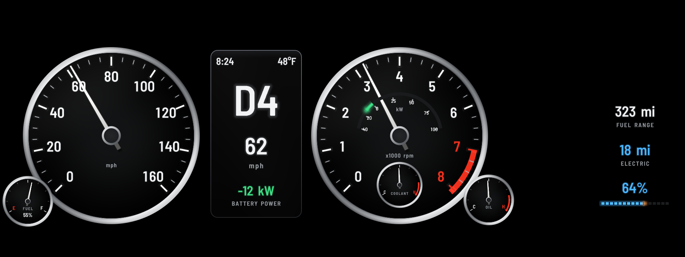

> [!IMPORTANT]
> 이 저장소는 개인 테스트 목적으로 만들었습니다. 악용을 삼가 주시고, 불법 행위나 금전적 이익을 위한 무단 사용을 하지 마세요.
>
> This repository is for personal testing. Do not misuse it, use it for anything illegal, or use it for profit without permission.

> [!WARNING]
> **Disclaimer.** This is an independent personal project: akakingj's version of eroobeeroo's iDrive 7 cluster apps.
> It is not affiliated with, endorsed by or supported by any vehicle manufacturer, equipment supplier or their
> partners.
>
> Everything in this repository is provided "as is", without warranty of any kind. Changing a vehicle's software,
> electronics or displays can cause malfunctions, distract the driver, void warranties, break local regulations
> and create safety risks. I am not liable for any damage, injury, loss or other consequence arising from the use
> or misuse of anything in this repository. **I do not recommend that anyone try this on their own vehicle**; if
> you do, you do so entirely at your own risk.

# AK iDrive 7 cluster apps

Three apps for the BMW iDrive 7 head unit (MGU): akakingj's versions of eroobeeroo's cluster apps
([eroobeeroo/idrive7-cluster-info](https://github.com/eroobeeroo/idrive7-cluster-info)), changed and tested on a
G20 and a plug-in hybrid. **They are free: if you paid for one, ask for a refund.**

| App | What it does |
|---|---|
| **[AK Cluster Layouts](apps/akakingj_cluster_layouts/README.md)** | your own layout on the whole instrument cluster, drawn by the cluster itself: fifteen layouts, each in three colour sets and with three centres (readings, Waze in the layout's window, stock), the car's own bottom strip kept; every reading the car gives in any place; a speed limit sign of its own that works as the car's |
| **[AK Cluster Centre](apps/akakingj_cluster_centre/README.md)** | the factory cluster kept, its centre taken over by pages of live data (temperatures, fuel and boost, warm-up, turbo cool-down, eDrive, a 0-60 timer, custom pages) |
| **[AK Cluster Info](apps/akakingj_cluster_info/README.md)** | a small panel of live values over the Waze map in the cluster or on the HUD; turn signal arrows, the lane change warning and the next turn on the HUD; the driving assistant check and the signal survey (what this car's head unit gets of the speed limit sign) |



**With the other AK apps** (separate repositories): **AK Cluster ID8** (`akakingj/myapp-cluster-high`) is another
whole-cluster app; with both on, the one that came up first keeps the cluster and the other waits, and the Car
profile's *Start on the cluster* picks which one takes it at every start. **Car profile** (`akakingj/myapp-id7`)
sets what these apps take from the car: the engine (Auto, petrol, diesel, M, plug-in hybrid), the red zone and
shift lights, the boost gauge's end, the units.

## Installing

Add `akakingj/myapp-cluster` as a source in the [MGU Store](https://github.com/robertnisipeanu/mgu-store) and install
the apps you want; the head unit builds each one from source (from `main`). What they need comes from the Store's
own sources, which it installs with them:

- the GPU renderer (`idrive7-renderd`) and controller gate (`mgu-inputgate`) from
  [cauliflowermossgrape/idrive7-apps](https://github.com/cauliflowermossgrape/idrive7-apps);
- the cluster renderer (`cluster-render`) that AK Cluster Layouts and AK Cluster Centre draw with, and Waze on
  cluster (*Maps on cluster*), the map AK Cluster Info sits on and AK Cluster Layouts hosts in its window, from
  [robertnisipeanu/idrive-apps](https://github.com/robertnisipeanu/idrive-apps).

[eroobeeroo/idrive7-apps](https://github.com/eroobeeroo/idrive7-apps) is optional: it has **eDrive Live**, which
shares the battery's charge, power and temperature with these apps. On a plug-in hybrid it is where the layouts and
pages get the charge and power: they leave the battery unit to it rather than read it too.

These AK apps have their own ids (`akakingj_cluster_*`), so the Store keeps them apart from eroobeeroo's own Cluster
Info, Cluster Layouts and Cluster Centre: install one or the other of each, not both, or both draw on the same
cluster or HUD.

**Branches:** `main` is what the Store builds; changes go to `test` first and reach `main` once they are released.

## AK Cluster Info

A small panel of up to three live values over the Waze map in the instrument cluster or on the HUD, and on the HUD
turn signal arrows, the lane change warning (the door mirrors' lamps) and the next turn (directions from BMW's
guidance service, for CarPlay, Android Auto and BMW's navigation). It works with
[Waze on cluster](https://github.com/robertnisipeanu/idrive-apps), which puts the map there. Its settings also hold
two read-only checks: the **driving assistant check** (what the cluster's assisted driving view is drawn from, and the
HUD data's speed limit figures) and the **signal survey** (one drive, *Start survey* to *Stop survey*, driving or
standing: every candidate for the speed limit sign that this car's catalog has, read and recorded). What it shows, its
settings and how other apps can give it values are in
[apps/akakingj_cluster_info/README.md](apps/akakingj_cluster_info/README.md).

### What it looks like


*In the instrument cluster: the battery's power with its bar (recuperating, in green), battery and oil temperature.*


*On the HUD: battery charge, battery and oil temperature, right of the HUD's own speed readout.*


*The panel as the app draws it, at twice its size on the cluster: what it can show, and its four colour themes.*

(Street names in the photos are blurred.)

## Logs from the car

Each app's **Logs** button saves everything needed to find a problem to a file (on a USB stick if one is plugged in
and writable, and always in the app's data folder) and shows it as QR codes, three a page: photograph each page and
put the text back together with

```sh
python3 tools/decode_logs.py photo1.jpg photo2.jpg ... -o logs.txt
```

The codes are `CLG2` (base45 in alphanumeric mode, since Info 1.11.1, Layouts 0.67.2, Centre 0.16.5: about 30 % fewer
codes); the tool reads the older `CLG1` too. Needs OpenCV (`pip install opencv-python-headless`).

## Repository layout

| Path | What |
|---|---|
| `apps/akakingj_cluster_layouts/` | AK Cluster Layouts: `layout_<id>.js` (one file a layout), `layout_common.js` (the glass's keep-out areas, readouts, gauges, helpers), `layouts.js` (the list and the page's places), `main.js` (its page) |
| `apps/akakingj_cluster_centre/` | AK Cluster Centre and its pages |
| `apps/akakingj_cluster_info/` | AK Cluster Info: `main.js` (its page), `overlay.js` (the panel over the map), `providers.js` (values from other apps), `indicators.js` (turn signals and day / night), `blindspot.js` (the lane change warning), `nav*.js`, `lane_draw.js` (directions on the HUD), `adas_probe.js` (the driving assistant check), `survey.js` (the signal survey), `logs.js`, `qr.js` |
| `shared/` | the code the apps share (the cluster engine and shaders, car data, fonts, the clock, logs and QR codes, the signed credit); `node tools/sync_shared.js` copies it into each app, which holds its own copy |
| `tools/` | the tests, the cluster previews (`preview.js`, `make_previews.py`, `preview_centre.js`), the keep-out check (`clearance.js`), the log decoder (`decode_logs.py`), the font baker and the credit signer |
| `kit/runtime/` | the app kit's runtime the build bundles into each app (canvas, fonts, gauges, themes, settings, translations, the controller and renderer clients, `survey_fit.js`) |
| `kit/platform/`, `kit/localization/` | the packages' permissions and the Chinese build's credit |
| `kit/tools/build.py` | builds an app package (with `pack_data.py`, `localize.py`, `make_icon.js`, `oapgen/`) |
| `kit/tools/test_*.js` | AK Cluster Info's and the kit's tests |
| `mgu-repo.json` | tells the Store how to build the apps (in Korean); each app's `app.json` says what it requires |

## Development

The tests need Node.js only (no SDK, renderer or car), and OpenCV for `test_logs.js`; the full list is in
`.github/workflows/tests.yml`:

```sh
for t in runtime cluster_info_overlay cluster_info_blindspot cluster_info_adas cluster_info_survey survey_fit cluster_info car_profile; do node kit/tools/test_$t.js; done
for t in engine app centre data finder logs providers shared signals slots hvsoc hvsoc_info pedal oilpress boost_psi cup_view daynight awake dap frozen fuel korean kwfuse presence readouts strip_fuel tight sli gauge_tops; do node tools/test_$t.js; done
```

After changing anything in `shared/`, run `node tools/sync_shared.js`; after changing a Korean text in
`kit/runtime/locales/ko.tsv`, `python3 kit/tools/sync_locales.py ko` (the build reads `ko.json`).
`python3 kit/tools/build.py <app id>` builds a package into `dist/`, and `node tools/test_built.js` starts each built
app on the kit's stubbed head unit. Both need BMW's oap-sdk in `oap-sdk/`, taken from your own head unit (see
eroobeeroo/idrive7-apps, `kit/tools/extract_sdk.js`). The SDK and the built packages, which contain it, are never
committed. The Store builds on the head unit with the unit's own SDK.

## License

Copyright (C) 2026 eroobeeroo; the AK changes akakingj. [PolyForm Noncommercial License 1.0.0](LICENSE): free to use, change and share for
any noncommercial purpose (your own car, a friend's, a hobby project), with this licence and the copyright notice
kept. **Commercial use is not licensed: nobody may sell these apps or charge for installing, coding or bundling
them.** If you paid for them, ask for a refund. That covers everything here except the parts below, which keep
their own licenses. Versions published before 10 November 2026 remain under the GPL-3.0-or-later they were
published with.

- The app kit (`kit/`) is from [cauliflowermossgrape/idrive7-apps](https://github.com/cauliflowermossgrape/idrive7-apps)
  through eroobeeroo/idrive7-apps, under its MIT license ([LICENSE-MIT](LICENSE-MIT), `kit/LICENSE`). Cluster Info
  was written there; versions of it published in eroobeeroo/idrive7-apps before this repository remain under the MIT
  license they were published with.
- The cluster renderer's Node client (`cluster_render_client.js`) is by Robert Nisipeanu, MPL-2.0, as its header says.
- ID7 M and GT3 follow bimmer-lab's Cluster Themes ([bimmer-lab/apps](https://github.com/bimmer-lab/apps)), and AK
  Cluster Info's directions on the HUD Redline's and jaimeen77's Cluster Redline 1.3.9, all MIT (`NOTICE.md`).
- Fonts: the cluster apps' Barlow, Michroma and Orbitron atlases, Cluster Info's IBM Plex glyphs and
  the bundled Noto Sans SC glyphs are under the SIL Open Font License 1.1 (`shared/NOTICE`,
  `apps/akakingj_cluster_info/NOTICE`, `kit/runtime/fonts/OFL-NotoSansSC.txt`).
- The Chinese translation's credit is in [NOTICE.zh-CN.md](NOTICE.zh-CN.md). More in [NOTICE.md](NOTICE.md).
