# Cluster Layouts

*Part of [iDrive 7 cluster apps](../../README.md), with Cluster Info and [Cluster Centre](../cluster_centre/README.md).*

Custom layouts for the whole instrument cluster of a BMW with iDrive 7 (MGU), **drawn by the cluster
itself**. Fourteen layouts, in the page's order: 90's, 20's, Old M, ID6 M, ID7 M and ID8 M (the last two after
bimmer-lab's M and Sport), JDM 1, JDM 2, GM, Track, Pulse, GT3 (after bimmer-lab's), KO 1 and KO 2, each in comfort, sport and efficient
colours (following the selector's S / M
programme, or chosen), each with three centres: the **readings**, **Waze** or the **stock** centre content.

With the car's own bottom strip (the default) the strip shows the gear, the drive mode, the ranges, the time and the
outside temperature, so no layout shows them a second time (ID7 M, ID8 M and Old M never show the time, the outside
temperature or the fuel range at all): the places the time and temperature had show the
battery's temperature (intake air on a petrol or diesel car) and the gearbox oil's, and where a layout had its gear
it now has the digital speed or another reading. With **Waze** in the centre, Waze on cluster (0.9.107 or later,
[eroobeeroo/idrive-apps](https://github.com/eroobeeroo/idrive-apps)) draws the map in the layout's own panel,
above it, filling the window exactly; under the layout the cluster drew its own map screen (its speed, edge shading)
over the map. Needs **Central display area: Map view** on the car. The MGU Store's own build (robertnisipeanu's
"Maps on cluster", waze-on-cluster 0.10.x, 2026-11-16) does not read the layout's window file: with it the map stays
in the car's map slot under the layout, seen through the window with the cluster's own map screen over it, as before
0.21.0. (Its renderer, cluster-render 0.6.x, can host a target in a scene drawn from a RAMSES file, which a layout of
shaders doesn't have yet.)

Every reading goes to the cluster within a frame of arriving: the needles and bars at 60 updates a second, the
digits every frame, and the battery's power the moment eDrive Live reads it (it writes each
reading at once and this app watches for it, instead of a quarter-second file cycle and a half-second scan). The
battery's own pace sets the limit: its current answers 10-20 times a second over diagnostics.

### The car's trip computer (0.45.0)

Every readout place (Readout 1 / 2, the main readout, the bottom line, and each layout's own readout places on the page)
can show the car's own trip computer: **Average fuel economy**, **Trip distance** and **Driving time** - and (0.45.1)
the **Fuel range** and the **Clock** (the time of day) - read-only,
from the cluster's KombiIF (`statusBordcomputerAverage`: trip 1's average economy and the unit the car shows it in;
`statusBordcomputerTravelData`: the distance and the driving time; as Live Data reads them), every 15 s and on each
change. **Settings > Fuel economy unit**: as the car's trip computer (the default; km/L with km/h, mpg with mph while
the car hasn't said), km/L, L/100km or mpg (US). KO 1's display shows all three (and the economy as a bar, 0 to 30
km/L), KO 2's the distance and the economy. A car that doesn't send them shows `--`. Each line of KO 1's and KO 2's
trip computer is a place on the page (0.45.1: *Trip computer: line 1-3*): any readout there, or nothing; KO 1's bar
follows its third line.

**Centre display: speed or trip computer (0.46.0).** 20's, ID6 M, Old M and GM can show the trip computer in their
centre display's big speed's place (Settings > Centre display, or on the page for each layout): three lines (GM: two),
each a place on the page (*Trip computer: line 1-3*: any readout, or nothing), as designed the distance, the driving
time and the average economy. With the speed shown, the lines' places are hidden on the page.

### KO 1 and KO 2 (0.44.0)

Two pairs of round dials after the look of the mid 2020s' Korean saloons' screens (original drawings of the idea, not a
copy of any one), their colours following the drive mode: comfort the speedometer blue and the tach amber, ECO PRO both
teal, sport both red under a bright bezel. **KO 1** is digital: no needles, each dial a dark disc with a glowing arc
from its start to the reading (in ECO PRO a fan of fine slats over the face) and the reading in large thin figures;
between the dials a display as 20's with readouts 1 and 2, the car's trip computer (distance, driving time, average
fuel economy with a bar; 0.45.0) and the main readout. **KO 2** is analog: thin numerals, fine ticks, a slim needle, the face
tinted and lit along its edge to the needle; between the dials 20's display (the speed in figures, the trip
distance and average economy, the main readout). Both have a thin arc across each dial's foot: the fuel (0, 1/2, 1, with the range) under the speedometer, the
coolant (C to H; a plug-in hybrid's charge, 0 to 100) under the tach; Settings > Speedometer gauge / Tach gauge (or
the page) put another reading in either. Shaders: BAND_FS (KO 1's arcs, both feet), RING_FS (KO 1's face and rim),
DIAL_FS (KO 2's dials, as 20's). 0.44.0 also puts GM's speed in the middle of its display (the car's strip shows the
gear, which stood left of it).

### The app's page: pick a layout, set its readouts (0.29.0)

0.30.0 took out Digital round, Modern wide and Digital dash (a layout saved as one of them becomes 20's, Pulse and
Track), renamed Retro, Analog sport, Classic M, M and Sport to 90's, 20's, ID6 M, ID7 M and ID8 M, and put the
layouts in that order; 0.30.1 renamed Arc tach and Twin cowl to JDM 1 and GM; 0.31.0 added JDM 2 after JDM 1; 0.33.0
renamed ID6 M (the E9x-style dials) to Old M and added a new ID6 M after it; 0.34.0 keeps the car's own bottom strip
always (the full-screen form is gone: below). 0.35.3: ID7 M and ID8 M show the gear with its programme (D4, S3,
M2), not the number alone; GM's rings of light follow the drive mode (ice-blue, red in sport, teal in ECO PRO). 0.36.3: a plug-in hybrid's charge bars go red at 10 % and under, every layout alike (the strip's, Pulse's, Track's, ID7 M's,
ID8 M's bottom bar and rev bracket bar; the battery gauge's figures). 0.36.1: the readouts (Readout 1 / 2, Main, bottom line) are Auto by default: by the car (petrol or diesel: intake air, gearbox oil,
torque, coolant; plug-in hybrid: each layout's eDrive reading), and any reading can be set on either car, the battery's
charge, temperature, power and electric range among them (the small gauges and the places too); ID8 M's rev bracket bar
is a plug-in hybrid's charge. 0.35.9: a plug-in hybrid's tach is a Power % meter in HYBRID and ELECTRIC
(the pedal's demand, eBOOST at the top, CHARGE below 0: the regeneration), the rev counter in SPORT and XTRABOOST;
HYBRID is comfort's colours, ELECTRIC ECO PRO's, XTRABOOST sport's. 0.35.7: Settings > Vehicle is Plug-in hybrid,
Petrol or Diesel (or Auto); on a diesel the intake air takes the ignition timing's place (none read). 0.35.4: JDM 1 keeps one look in
every drive mode; JDM 2's tach is red in every mode with the red line marked on its rim, and only the gear's disc
follows the mode (blue, red in sport, teal in ECO PRO).

```
+---------------------------+  JDM 1                         Showing on the cluster
|                           |  Layout                     live · 88 km/h · 3200 rpm
|  the layout, large        |  [ Main readout: Boost  ]  [ Readout 1: Intake air ]
|  (its demo picture)       |  [ Readout 2: Gearbox   ]  [ Speedometer gauge      ]
+---------------------------+  [ Tach gauge           ]
 <  [card] [card] [card] [card] [card] [card]  >          (14 layouts and Stock)
```

- **The cards:** every layout's picture (made beforehand with demo readings for a petrol car, km/h, °C:
  `previews.wad`, from `python3 tools/make_previews.py`, which draws each with `tools/preview.js`), as it looks over
  the car's own strip (the layout above it and a grey stand-in for the strip the car draws), six a row, the
  arrows for more. A tap shows that layout on the cluster at once (Show on the cluster turned on with it); in Sport
  or ECO PRO with a layout set for that mode (Settings > Layout in Sport / in ECO PRO) the tap changes that one.
  **Stock** turns the layout off: the stock cluster back.
- **The readouts:** the places the layout has for Settings' readouts (main readout, readouts 1 and 2 in the time's
  and outside temperature's places with the car's own strip, Old M's and GM's bottom line, the small gauges
  in the speedometer and the tach), only those that show on this car with these settings (`layouts.js` SLOTS, which
  `tools/test_slots.js` checks against what each layout draws). A tap lists the values: one set there is that
  layout's alone (Settings > slotsBy, a bar on its left), *Same as in Settings* follows the Settings' value again,
  which stays every layout's default (*Common*).
- **Every other place (0.35.0):** each layout's places that had a fixed reading - 90's gauge between the dials (also an
  analog clock, 0.35.1, on Settings > Time zone), 20's
  gauge in the tach's foot, ID7 M's four card gauges and two corner arcs, ID8 M's bars in the brackets and the bottom
  bar's halves, JDM 2's four temperature quarters, Track's six tiles, Pulse's bottom row, GT3's boxes and the
  readings under the gear - are cards on the page too, set for that layout alone (a gauge place any small gauge's
  reading, with its scale, red zone and figures; a readout place any readout). *The layout's own* keeps it as
  designed. With more than six the cards go three or four a row.
- **JDM 1's water cup, large (0.43.0):** JDM 1's page has a **Water cup view** button: the cup of water on the
  head unit's screen, as the Water Cup app draws it (no other app needed), sloshing with the same G as the cup on the
  cluster (2.2 times it, higher on the outside of the bend). **Back** (or Signals, Logs) leaves
  it. Worked out every frame, sent only when the water moved and at most 30 frames a second (`cup_view.js`,
  `tools/test_cup_view.js`).
- **Status, raw values, the renderer and the signal list** moved behind the **Signals** button (its first page).

### 90's

A tribute to the round-dial clusters of the 1980s and 90s: matte black faces with a thin dark rim, numerals
and ticks lit orange the way those clusters glowed at night, long slim red-orange needles over black hub caps.
A fuel gauge is set into the speedometer (the reserve in red), an economy gauge into the tach (the battery's
power on a plug-in hybrid, 0 a quarter round, recuperation below it in green; boost with Vehicle: ICE), a small coolant gauge sits
between the dials over an amber LCD with the speed. With the engine off the tach's legend reads the battery's power. Comfort colours
are the classic orange, Sport a deeper red-orange, Efficient white daytime markings. An original design: no
maker's marks or names.

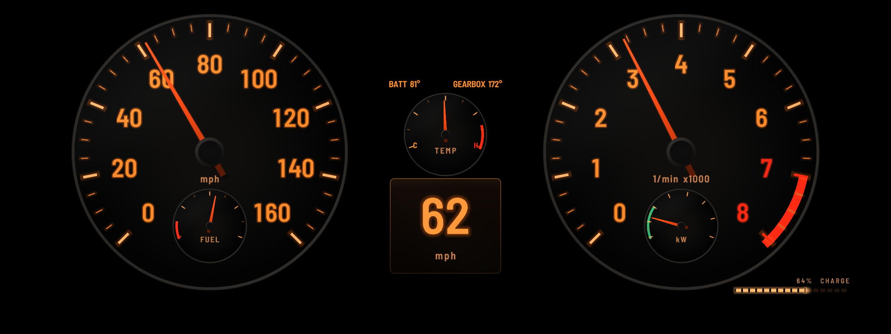

| Sport colours | Efficient colours |
|---|---|
| 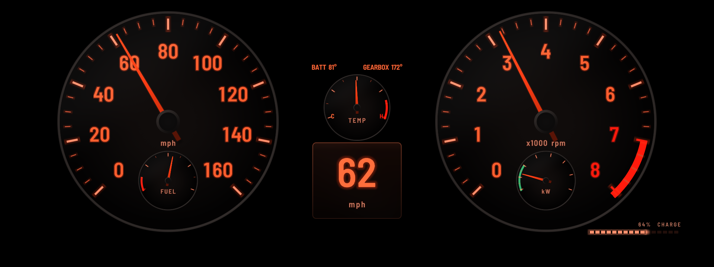 | 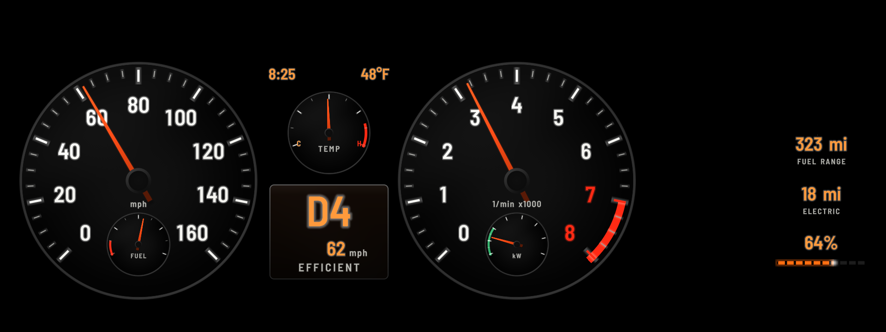 |

### 20's

A classic sports-saloon pair of round dials, after the look of the 2010s' analog clusters (an original drawing, no
maker's marks): black faces with crisp white markings and numerals, bright chrome rings, slim white needles over dark
hubs and a short red zone on the tach (km/h to 260, numbered every 20). A small coolant gauge is set into the tach's
foot, and two small satellite gauges are tucked against the dials' outer edges: the fuel by the speedometer, the oil by
the tach (Settings > Speedometer gauge / Tach gauge, or the page, put another reading in either; with another
reading by the speedometer the strip's fuel bar comes back). A slim display between the dials shows the time and
outside temperature, the gear, the digital speed and the main readout. On a plug-in hybrid in an electric mode the
rev counter reads the battery's power (90's likewise): 0 a quarter of the way round, the power drawn above it and
regeneration below it in green, each to the battery's own limit as eDrive Live reads it (100 and 35 kW without eDrive
Live); in the hybrid, sport and battery control modes it is the rev counter with a small power gauge inside, on the
same scale (its 0 a quarter along the arc). Every power gauge in every layout works this way.

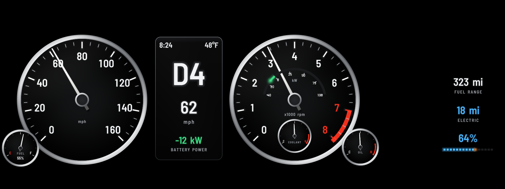

| Sport colours (S on the selector) | Map in the centre |
|---|---|
| 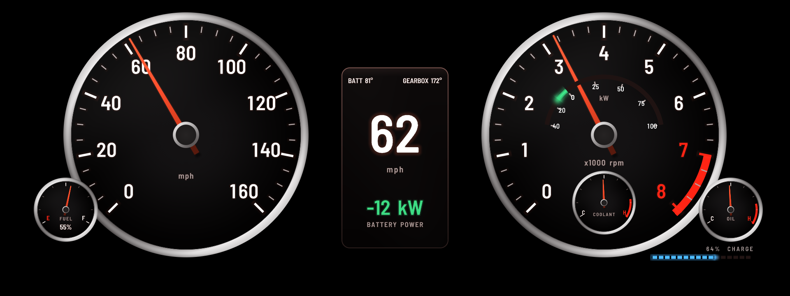 | 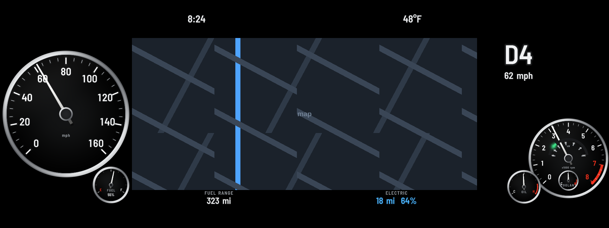 |

### Old M

The round dials of BMW's M cars of the late 2000s, drawn after a photo of an E92 M3's cluster at night: black faces,
a ring of cool white-blue light round each scale (open across the bottom), white bars, dots and numerals (one scale:
mph or km/h, as set; km/h to 260, numbered every 20), thin glowing red needles over dark hubs, the fuel gauge across the speedometer's foot
and the oil temperature across the tach's, and one amber LCD between them under the M tricolour: the battery's
power along the top, the speed in large figures in the middle, the charge along the bottom (the charge is in the display, so the strip's charge bar isn't added). In
an electric drive the tach reads the battery's power in kW: 0 a quarter round, the ring green below it for
regeneration. An original drawing.

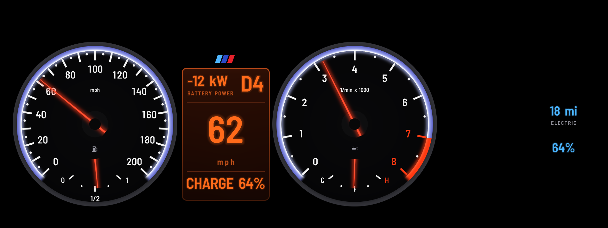

### ID6 M

Round dials after the M cars' analog clusters of the mid 2010s, an original drawing (the M tricolour, no lettering):
two big dials, each with a thin white ring round its top, open at the bottom, a dark band with white marks and large
numerals, a darker disc in the middle and a long red-orange needle; the tach's shift lights along the outside of its
top end, amber from Settings > Amber zone below the red zone and red from the red line (both lower while the oil is
cold, as the red zone); the gear under the tach in a white arc; the speed in figures with its unit at the bottom of the middle, between the dials; no
readouts beside the dials (the car's strip shows the time, temperature and ranges); a small fuel gauge (0, 1/2, 1) left of the
speedometer and a small engine oil gauge (70-170 °C, 160-340 °F, red from Too hot) right of the tach, either of which
Settings > Speedometer gauge / Tach gauge (or the page) can give another reading.

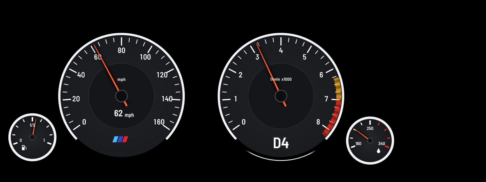

### ID7 M

The M8's M view: the backdrop and the two bowed rev blades from bimmer-lab's M theme
([bimmer-lab/apps](https://github.com/bimmer-lab/apps), MIT; their own shaders, traced off an M8's cluster), the
blades in blocks of 1000 rpm with a thick silver outer edge, ticks standing out from it and a red block at the foot,
the scale 0-8 with the numerals every 2000, the gear's programme small and grey beside its number (D 4), the speed
under the line, and the M8's flat gauges in its own manner (an icon over the bar, the unit at the right, a white fill over a
thin track with its red zones, the scale's numbers under it; each temperature's reading in figures beside its icon,
red when hot): in the cards the coolant and oil temperatures (the gearbox oil's in place of the oil on a petrol
or diesel car) on the
left, and on the right the battery's power (its first quarter, left of the 0, regeneration in green) and
temperature on a plug-in hybrid, the boost and torque on a petrol or diesel car; in the bottom corners arcs for the
fuel level (left, with the range) and the charge with its percentage (right; the oil temperature on a petrol or
diesel car), so the strip's own bars aren't added. In an
electric drive the blades read the battery's power in kW: 0 at the 2000 mark, regeneration below it in green to the
battery's limit, the power drawn above it to the blades' top. Its colours follow the drive mode as the M8's: silver
glass in comfort, lit red in a sport mode, blue in ECO PRO and on electricity alone. With the Waze map the map goes
in the window between the blades.

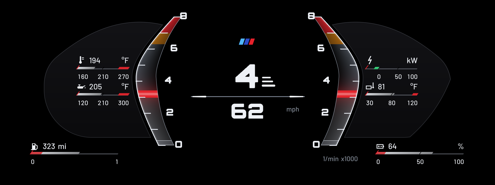

| Map in the centre |
|---|
| 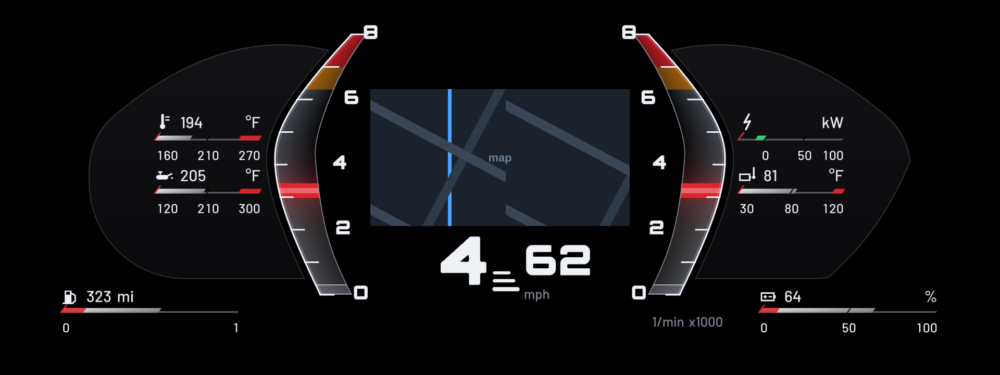 |

### ID8 M

The iDrive 8 M cars' Sport view (km/h to 260: 0-180 in 30s, then 220 and 260), from bimmer-lab's Sport theme (their shader, MIT) brought closer to BMW's own: the
blue speed bracket and the red rev bracket with flares where they bend and meet the bottom line, segmented fuel and
oil bars, and the bottom bar's halves as gauges (the charge on blue and the battery's power on red, green while
regenerating; boost and coolant on a petrol or diesel car). In an electric drive the rev bracket reads **ePower %**
(the share of the most the battery gives), as BMW's electric M cars do, its bottom quarter regeneration (green, to
the most it takes). The rev bracket's colour follows the drive mode: red in a sport mode (as BMW's Sport view),
silver in comfort, teal in ECO PRO and on electricity alone. The cruise control's
icon is grey, and green with the set speed beside it while the cruise control holds a speed (the driving assistant's
own services; those send nothing on the G05 tried, so else the head-up display's set speed,
`DisplayDataServer.functionalLibraryData`). Pressed 5% in height to end at the car's own strip; with the Waze map the map
goes in the window between the brackets.

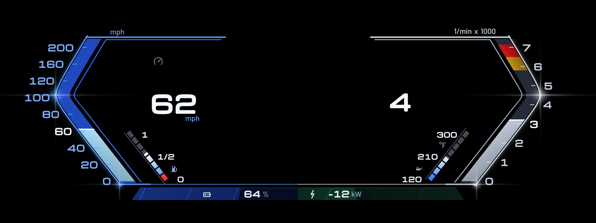

| Map in the centre |
|---|
| 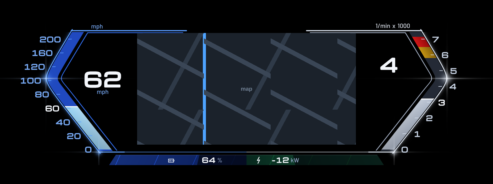 |

### JDM 2

An original drawing after the idea of a Japanese grand tourer's digital cluster (no maker's marks or names): a dark
carbon-weave panel; a big round window on the left (Settings > JDM 2: left dial, or set for JDM 2 alone on the page: the **G meter**, the
default, a **speedometer** with its marks round the edge, the **tyres** - the car from above, each tyre's pressure and
temperature at its corner, a low one in red - or four **temperatures** - engine oil, coolant, gearbox oil and intake
air, an arc each, red when too hot) with the G meter (the car's own lateral and
longitudinal acceleration, read as G Force and Car Vitals read it: each axis's offset learned while the car stands,
smoothed over about 150 ms; the dot as the driver feels the G - right in a left bend, down accelerating, up braking,
as every app since 0.47.0, no setting - with its trail behind it as G-Force's, a thin line through where it was over the last 3.2 s, fading; Settings >
JDM 2: G meter size); over its edge a big tach whose scale is a broad coloured band
with the numerals in it, a notched dark rim round it and a dotted line inside it (red, the shift zone orange; Sport
crimson and amber, Efficient blue), a glowing needle reaching the band over a chrome ring hub, the digital speed in
its open lower right; a glossy disc with the gear; two small chrome-ringed gauges, the coolant (C-H) and the fuel
(E-F), which Settings > Tach gauge / Speedometer gauge (or the page) can give another reading; the readouts in a column
at the right (readouts 1 and 2 in the time's and temperature's places, the main readout). On a plug-in hybrid in an electric mode the tach's band reads the battery's power, its regeneration
part green. With the map (or the stock centre) the tach stands left of it and the disc and gauges right of it. Its
parts are one shader (`shaders.js` JDM_FS).

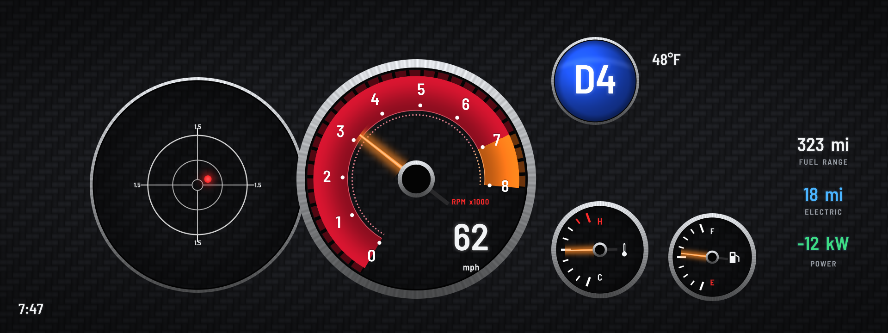

### Track

A motorsport data display: a row of shift lights (green, yellow, then red, all flashing red 300 rpm before
the red line) over a segmented rpm bar, a huge gear with the engine speed in the middle, tiles for oil,
coolant, boost and battery power either side of it (over the car's own strip, which shows the gear, the card holds
the engine speed, large, instead) (timing and torque with Vehicle: ICE), the speed large on
the left with a **0-60 timer** (it times every run from a stop to 60 mph, or 0-100 km/h, and keeps the best of
the drive) and the drive's peak power (or boost), and the ranges and charge right of the KOMBI's box.

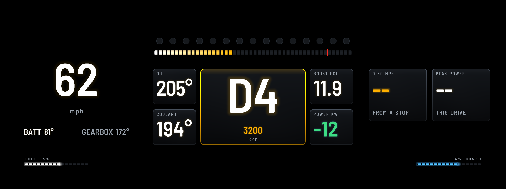

| Sport colours at the shift point |
|---|
| 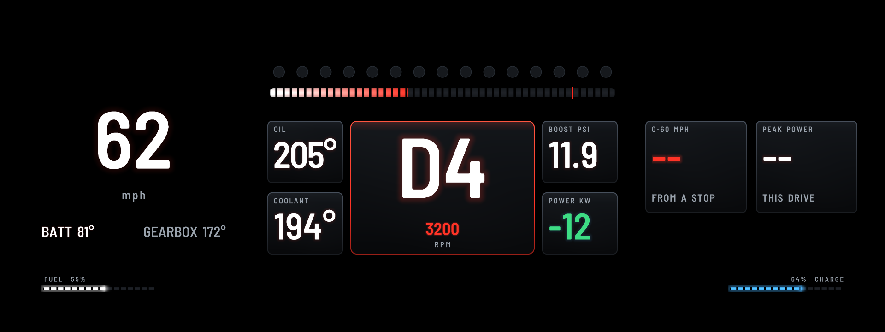 |

### Pulse

Made for the car's own bottom strip, in large type: the speed large in the middle with the battery's power and the
engine speed either side of it at the same height, one long segmented bar under all three for the engine speed,
nearly the panel's width, red from the red line, and one row along the bottom: oil, coolant, the charge, the
battery's temperature and the gearbox oil. Its colours follow the drive mode. With Waze in the centre the speed
sits beside it and the rpm bar runs under it.

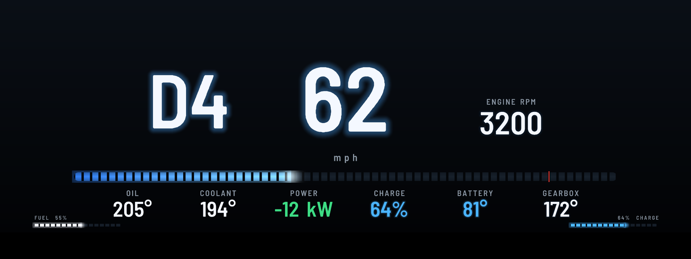

| Sport | Map in the centre |
|---|---|
| 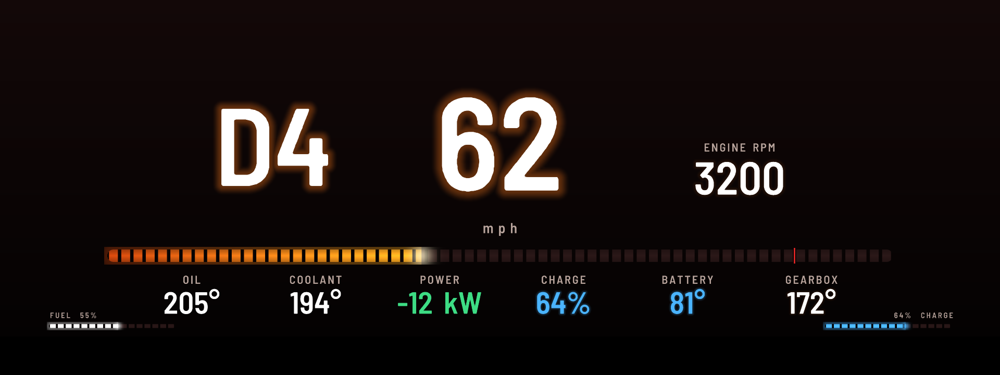 | 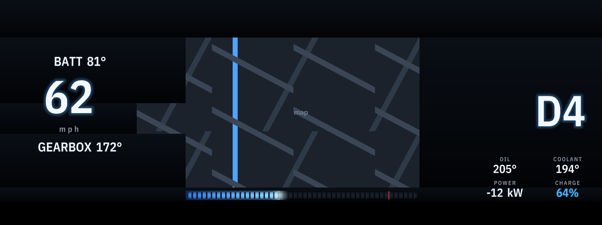 |

### GT3

A race dash, after bimmer-lab's GT3 theme for Cluster Themes ([bimmer-lab/apps](https://github.com/bimmer-lab/apps), MIT):
its arrangement and its shift grading, redrawn with this app's engine and fitted to the G05 and a plug-in hybrid.
Eighteen round shift lights over a segmented rev bar (the lights fill to the shift point, the red line less 300
rpm, pulled down while the oil is cold, and all flash there); the gear huge in the middle with the coolant and oil
under it; on the left the speed, the engine speed (OFF in an electric drive) and the **tyres**: pressure and
temperature at each corner from the car's tyre monitor (read every 10 s); on the right the battery's power, the
charge, and the last upshift with its grade (EARLY, SPOT ON, LATE, COLD REV or LIMITER). On a petrol or diesel car,
or with Show: Engine, boost and the shift point take the battery's places.

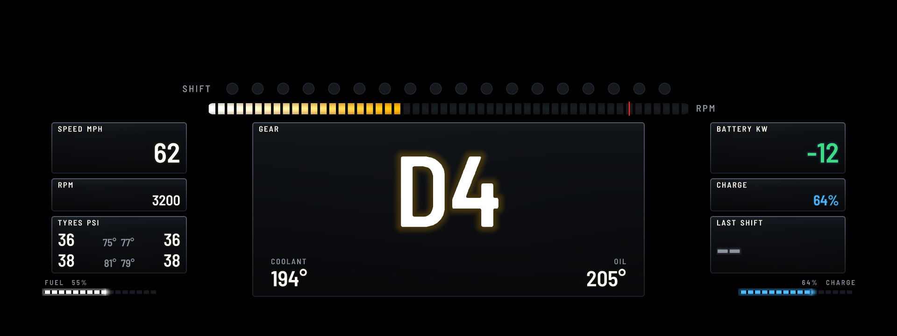

| Sport colours at the shift point |
|---|
| 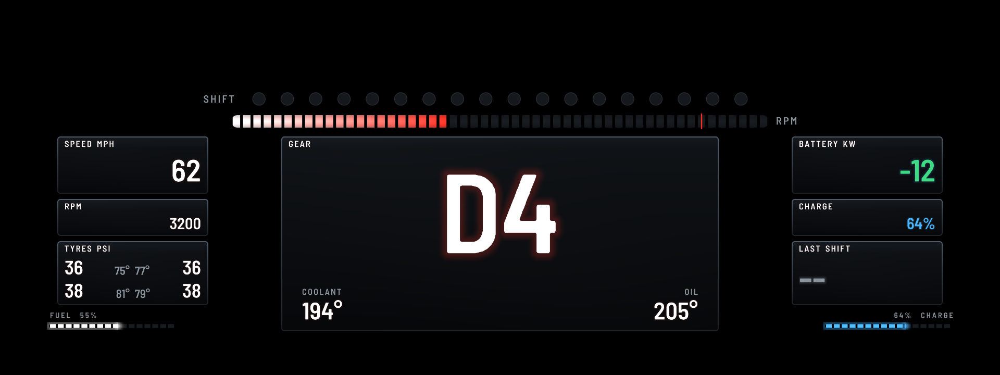 |

*(Drawn by `tools/preview.js` from the same shaders the cluster runs; the map is a stand-in for the real one.)*

## Readings and where they come from

| Reading | Source |
|---|---|
| speed, engine speed, gear, oil, coolant | the car's signals (`kit/car.js`); both apps read through `shared/data.js` |
| S / M programme (the gear's letter, the Auto colours) | `MDrive.dataDisplayGearbox` |
| outside temperature | `EnvironmentalInformation.ExteriorTemperature` |
| gearbox oil | `BasicDataSet.basicDataSet` |
| battery temperature, where the power goes | `Efficiencytainment2.statusBatteryTemperature`, `KombiIF.statusDisplayElectricalPowerDistribution` |
| intake air, boost | the engine unit over UDS, as M Vitals reads it (only while a layout that shows them is up) |
| battery charge and power | eDrive Live, through the shared folder `/dev/shm/cluster-info` (asked for while the layout shows and the car is switched on, as Cluster Info does) |
| fuel range, electric range | an app that shares them (eDrive Live, `values.frange.km` / `values.erange.km` in that folder), else the car's `KombiIF.statusRangeTankStatus` and `VehicleInformation.Range`, numbers picked by field name (`shared/data.js` `rangesOf`) |
| drive mode (SPORT, SPORT INDIVIDUAL, HYBRID, HYBRID COMFORT, HYBRID ECO PRO, ELECTRIC, ELECTRIC INDIVIDUAL, BATTERY CONTROL, ADAPTIVE, + XTRABOOST) | `FES.statusFESVehicleDynamicSwitchHMI` (and `statusSwitchDriveDynamicSport2`), decoded with BMW's FES mode table (TAB_FES_MODUS_ARG); the Auto colours follow it |
| steering angle, yaw rate | `SteeringAngle.ActualSteeringAngleDriver`, `CDS2.statusYawVelocityVehicle` (scaling in `config.scaling`, from the CAN signals, to confirm) |
| engine running, why it started | `CDS.statusEngineStatus` (its strings as the car sends them), else engine speed |
| time | the head unit's clock |

**Signals page.** Every field above is one an installed app already declares with the same flags
(`tools/known_signals.json`; a field the car's catalog doesn't have makes the install fail). Where the field
names inside a value differ by car, the app shows what the car sends: press **Signals** on its page for (1)
the raw drive-mode, range, engine, steering and yaw values, (2) what the cluster has up besides this app
(every display slot the KOMBI reports), then (3...) every range, fuel and
charge signal in the head unit's own catalog. A photo of those pages is what's needed to wire anything that
still reads `--`.

**Needs Cluster renderer 0.4.2 or later**, the Store's own (it draws 64 layers an app, and every piece of a
layout is a layer), from [robertnisipeanu/idrive-apps](https://github.com/robertnisipeanu/idrive-apps), one of
the Store's own sources; the Store installs it with the app.

**Logs.** The apps can't be reached from a phone over Wi-Fi: the head unit's firewall lets nothing connect
in, and an app's traffic out only through what the uplink allows. Instead, **Logs** on Cluster Layouts' page
shows what's needed (the renderer's status and slot report, the raw signals, the data now, the last lines of
the renderer's, this app's and Cluster Centre's logs) as QR codes, three to a page: photograph each page
(press Logs for the next) and send the photos; `python3 tools/decode_logs.py photo*.jpg -o logs.txt` puts the
text back together. The full logs go to a file on any USB stick plugged into the car
(`cluster-logs/cluster-logs-<time>.txt`) and to the app's data folder.

**The car's own bottom strip, always** (since 0.34.0): the layout ends at y 646, so the KOMBI's own strip along the
bottom shows below it (the fuel range, the time, the street, the drive mode and gear, the outside temperature and the
electric range, and the warning lights; 660 just touched the top of its drive mode). Found and tested on cars by
thatgrayg22. Over the strip the KOMBI leaves none of the dark boxes it puts over a full-screen layout (its gear
readout's place right of centre, the eDrive box, an M car's two in the middle), so every layout stands in its full,
centred form, as first drawn. The full-screen form, which covered the strip and bent each layout round those boxes,
is gone, and with it Settings > Bottom strip, Cluster: M car, Frame behind the gear box, Background (Pure black hid
the gear box; the layouts are now always as designed) and JDM 1: the gear in the arc. The layouts' own fuel and
electric range numbers are left out (the strip shows both), and where a layout has no fuel or charge gauge of its own
a fuel bar sits above the strip's fuel range (bottom left) and a charge bar above its electric range (bottom right).
With the stock centre the layout takes the same form as with Waze, its window left clear for the car's own centre
content.

### Nothing asked of a parked car

Every diagnostic read (and every read eDrive Live makes for the shared power) goes through the car's gateway and
wakes its networks. **Show** stays on with the car locked, so the layout alone can't say when to stop: until 0.27.2
it kept asking, and the car couldn't sleep (body controller 801C16 - 801C18 "no sleep in parking state", the engine
unit's switch-off time missing, *Battery management: malfunction while shutting down the vehicle electronics*). Now
`shared/data.js` reads nothing and asks eDrive Live for nothing unless the car is switched on, by its own state
(`VehicleCondition`, `kit/awake.js`: ignition on, ready to drive, driving), or, before the car has said, moved or ran
in the last 3 minutes. The layout itself stays up; its readings simply stop until the car is on again. After
installing, clear the stored faults once (Fault Scanner) and check they stay away.

## Vehicles

Made and measured on a G05 X5 xDrive45e (iDrive 7 MGU, the 12.3" Live Cockpit Professional cluster); every
car is taken to have the same cluster. What differs between cars is a setting, or found from the car:

- **Vehicle** (default **Auto**): found from the car the way other apps identify one before assuming
  anything: a plug-in hybrid's drive mode names, eDrive Live sharing its battery readings or the car giving an
  electric range say plug-in hybrid; none of these in 90 s shown, while the engine unit answers, says petrol
  or diesel. A petrol or diesel car gets the engine readings (boost, timing, torque, fuel rail), its own drive
  modes and no eDrive page. Or set it.
- **Fuel tank size** (40-90 L, 69 for an X5 45e): the fuel bar.
- The battery's charge and power come from **eDrive Live** only: this app never asks the battery unit itself
  (two apps asking it in turn left both without answers).
- **Battery power (kW)**: *Fast* (the default) moves every power gauge as the car accelerates or regenerates, without
  waiting for eDrive Live's next reading. The car's own signals that move with the battery's power, each fitted
  continuously to eDrive Live's readings of the battery (`shared/kwfuse.js`), the best fitting one shown: the stock
  cluster's own power meter (`Efficiencytainment2.statusPowerRelativHybrid`, electric drive and recuperation in %),
  the sport display's powertrain power (`FES.displaySportPowertrain`, on electricity), the onboard computer's
  consumption now x the speed (`ResetLogic.currentConsumption`), and the power at the wheels from the speed and
  acceleration (on electricity). With the engine running and none of the car's signals fitted, and with *eDrive
  Live's readings only*, the readings as they are. Nothing shows when eDrive Live has said nothing for 4 s. Logs >
  *fast power* shows each source: how often it came, its fit and its average miss in kW.
- **Electric range when full**: the estimate shown (with ~) until the car's own electric range arrives.
- The glass and the KOMBI's boxes (the camera cowl, the gear bracket, the eDrive box, the warning lights)
  are taken as the same on every car with this cluster (`layout_common.js`; every layout is checked against
  them by `tools/clearance.js`).

**Clock:** the unit runs its apps on UTC, so both apps take the time zone from Settings > Time zone (US
Eastern by default; US and EU daylight saving built in; Korea / Japan as a fixed UTC+9) and Settings > Clock
(12- or 24-hour).

## How it gets onto the cluster

The head unit never sends a picture of the cluster: a whole 1920x720 frame is 5.5 MB, and the link to
the KOMBI carries about 11.5 MB/s for everything, including the HMI's own content.

- The cluster is drawn with **RAMSES**: the head unit publishes a *scene* (a graph of quads, shaders,
  textures and uniforms), and the KOMBI's own renderer subscribes to it and draws it on the cluster's GPU.
  BMW's HMI draws its own cluster content this way.
- The [cluster render service](https://github.com/robertnisipeanu/idrive-apps/tree/main/native/cluster-render)
  (`cluster-render`, from idrive-apps) is that publisher for apps. It asks the KOMBI for display slots
  through Dcsm2. Its **`panel`** target is slot **0x203**: the whole 1920x720 cluster, over the stock
  gauges and **under the warning lights**.
- Each piece of a layout is an **effect layer**: a small GLSL ES 1.00 fragment shader over its own rectangle
  (`shared/shaders.js`). The dial (face, ticks, red zone, numerals, needle, hub) is one shader; each text is
  another; the background is a flat colour.
- **The render service draws at most 8 layers for an app** (32 for all apps together), so only a layout's
  first 8 pieces show today; the rest are refused (the app's page says so). Drawing many pieces with one big
  generated shader instead made the cluster restart, so that is not done. The way on is the render
  service allowing more layers an app.
- What is sent:
  - **once**: the shaders, their colours and one glyph atlas (a 1.5 KB-per-glyph distance field, ~96 KB):
    about **128 KB** in all;
  - **while driving**: the needles' values when they moved, and texts and colours when they changed: about **2.5 KB/s** at most (`tools/test_engine.js` measures it); **nothing** while nothing
    changes.

## Install on the car

1. Nothing else to add first: the Store installs what the apps need from its own sources, the cluster
   renderer from [robertnisipeanu/idrive-apps](https://github.com/robertnisipeanu/idrive-apps) and the GPU
   renderer and controller gate from [cauliflowermossgrape/idrive7-apps](https://github.com/cauliflowermossgrape/idrive7-apps).
2. In the Store, add the GitHub repository `eroobeeroo/idrive7-cluster-info` as a source. The head unit builds
   the apps from source; no token is needed.
3. Open **Cluster Layouts** and press **Show on the cluster**. Settings: layout, colours (Auto follows S / M),
   centre (readings, map or stock), mph / km/h, °F / °C, Nm / kgm / lb-ft, psi / bar / kPa (or with the speed unit), red zone, rev scale, the needle sweep at start.

## Safety

- **Off by default.** Nothing covers the stock cluster until *Show on the cluster* is on.
- **Warning lights stay on top**: the panel slot is under the telltales.
- **The stock cluster comes back by itself** when the app stops, when the render service stops (its layers
  go with the connection), when *Show on the cluster* is off, while the car's signals do not answer, and while
  they stop coming with the engine running or the car moving (3 s without a speed / rpm sample: the last speed
  would otherwise stay up), and while the car is locked and left (nobody sees it, and the cluster can sleep).
- The speed is the car's speed signal (`Vehicle2.statusCarSpeed2`, the centre of gravity), not the
  cluster's indicated speed, which by law reads a little high: expect this layout to read a few % below the
  stock speedometer.
- **The panel and the HUD share a scene id** (the KOMBI takes only two): while another app draws on the
  HUD, the panel cannot come up and the app's page says `scene id in use by another target`. Stop the HUD
  apps to use a layout.
- **Not seen on the car yet:** the KOMBI's renderer running these shaders (precision and speed on its
  GPU), whether the stock Check Control pop-ups still show above the panel, whether the map (slot 0x100)
  shows through the map window while the panel is up, and where the warning lights sit against the strips
  above and below the map. Check these parked before driving with it, and switch it off if anything is hidden.

## Writing a layout

The renderer side both apps use (engine, shaders, glyph atlas, render client, providers, signal finder) lives
in `shared/`; edit it there and run `node tools/sync_shared.js` (each app ships its own copy).

A layout is one file, `apps/cluster_layouts/layout_<id>.js`, listed in `layouts.js` and in `app.json`'s
`layout` setting. It lists **pieces** and draws nothing; `layout_common.js` has helpers (texts, readings,
bars, units, the map window). A piece is one shader in its rectangle (`engine.js` has the full list of fields; a
dynamic text's `chars` sets how many glyphs it can show):

| kind | what the cluster draws | main fields |
|---|---|---|
| `flat` | a colour | `colors: { color }` |
| `panel` | a rounded card: gradient, top light, border | `params.u_box` (radius, border, light, opacity) |
| `dial` | a round dial with its needle: face, metal bezel, ticks, red zone, numerals, backlight, value arc, shadow, hub, glass | `params.u_scale`, `u_arc`, `u_needle_dim`, `u_look`, `u_look2`; `value(d)`, `max` |
| `band` | a gauge along an arc (or a straight bar): segments, gradient fill, red zone, glowing tip, marks, numerals | `params.u_geo`, `u_span`, `u_marks`, `u_red`; `value(d)` 0..1 |
| `mdash`, `mtach`, `sdash`, `licon` | bimmer-lab's M backdrop, M rev blade, whole Sport view and line icons (their shaders) | their layout JSON's numbers as `params`; readings through `dyn` |
| `mbar` | an M8 side gauge's bar: thin track, thicker fill (white, or blue below its zero), red zones, start tick, notches | `params.u_zero`, `u_zones`, `u_marks`; `value(d)` 0..1 |
| `e9x` | a classic M dial: ring of light, bars, dots, numerals, a second scale, a small gauge at its foot, needles | `params.u_scale`, `u_arc`, `u_inner`, `u_sub`; `value(d)`, `dyn` `u_subv` |
| `chevron` | a gauge along two straight segments (A, the corner B, C): track, gradient fill, white marker, glowing outer line, inner line, shift dashes, ticks, numerals beside it | `params.u_ab`, `u_c`, `u_lines`, `u_marks`, `u_nums`, `u_red`; `value(d)` 0..1 |
| `text` | a line of glyphs with an optional glow | `text` (fixed, or `(d, t) => string`), `align`, `tracking` |

```js
const C = require('./layout_common');
module.exports = {
    id: 'my_layout', title: 'My layout', gearText: C.gearText,
    palette: (look) => ({ bg: '#000000', text: '#ffffff', glow: '#3fa6ff', dim: '#5d6f82' }),
    pieces(o) {
        return [
            C.flat('bg', 0, 0, 1920, 720, 'bg'),
            C.text('gear', 800, 150, 320, 190, C.gearText, (t) => ({ color: [t.text, 1], glow: [t.glow, 0.5] })),
        ].concat(C.reading('fuel', 800, 400, 320, 40, (d) => C.distText(o, d.frange), 'RANGE',
            (t) => ({ color: [t.text, 1], glow: [t.glow, 0] }), (t) => ({ color: [t.dim, 1], glow: [t.glow, 0] })));
    },
};
```

`o` holds the options (units, red zone, rev scale, centre: `info`, `map` or `stock`); `d` the car's data
(`speed` km/h, `rpm`, `gear`, `stage`, `mode`, `oil`, `coolant`, `outside` °C, `soc` %, `kw`, `erange` and
`frange` km); `t` the layout's palette for the look now. Texts use the glyphs in `font.js`; add more there. A layout's
`font` picks its face for every text and numeral: `'bold'` (the default), `'light'`, `'wide'` (Michroma, Sport) or
`'orb'` (Orbitron, M); its `mapWindow` ({ x, y, w, h }) where Waze on cluster draws the map, if not the native map area.

Check it before the car:

```sh
node tools/preview.js --layout my_layout --look sport --centre map --out preview.png   # WebGL, the cluster's shader language
node tools/test_engine.js && node tools/test_app.js && node tools/test_finder.js && node tools/test_centre.js && node tools/test_shared.js
node tools/preview_centre.js --page edrive --accent orange --out page.png                # a Cluster Centre page
python3 kit/tools/build.py cluster_layouts     # needs an oap-sdk/ folder (a stub is enough to check the build)
```

`preview.js` needs Node with Playwright and Chromium.

## Free and open source — the credit mark

These apps are free. If you paid for one, ask for a refund. Each app shows this on its own screen on the head
unit (the app menu), with a link to this repo. The notice is not drawn on the cluster glass — only in the app.

The credit is **signed** (`shared/attribution.js`, `shared/attribution_sig.js`):

- `attribution_sig.js` holds the author's **public** key, a signature over the credit text, and a key
  fingerprint. It is committed.
- The matching **private** key lives only in `secret/attribution_key.pem`, which is git-ignored and never
  pushed. Keep a backup of it somewhere safe.
- At start-up each app verifies the signature. An official build shows the dim credit and its key fingerprint. A
  build whose credit text was changed can't be re-signed without the private key, so it fails the check and shows
  a red **MODIFIED BUILD** notice on the app screen instead.

Honest limit: this is open source, so anyone can fork it and delete the check in their own copy — nothing can
stop that. What the signature does stop is a reseller passing a modified build off as an official, unmodified
one: users can see the mark flip and check the fingerprint against this repo.

After an **intended** change to the credit text, re-sign:

```sh
node tools/sign_attribution.js     # signs with secret/attribution_key.pem, rewrites attribution_sig.js
node tools/sync_shared.js          # copies the shared files into each app
```

## Notices

See [NOTICE.md](../../NOTICE.md).
